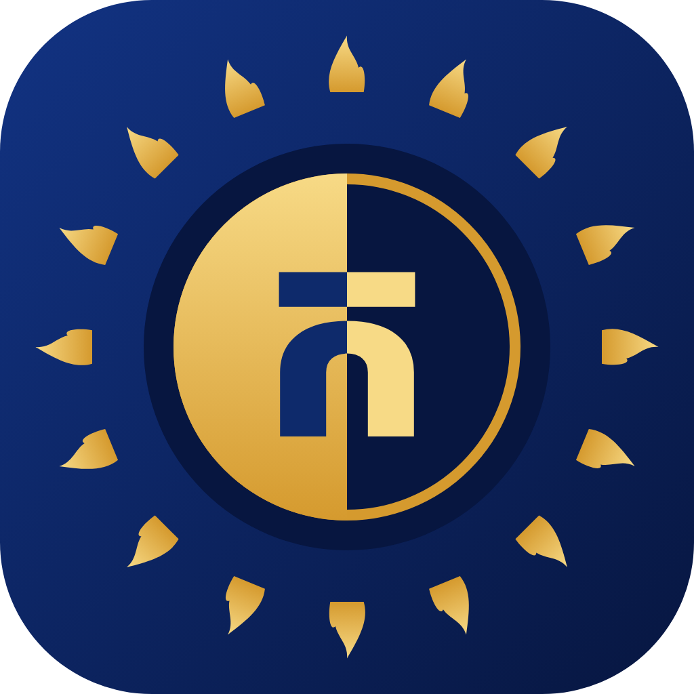
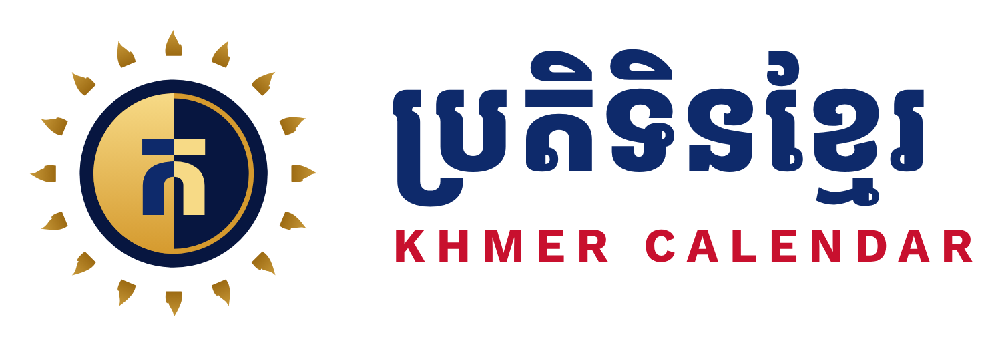
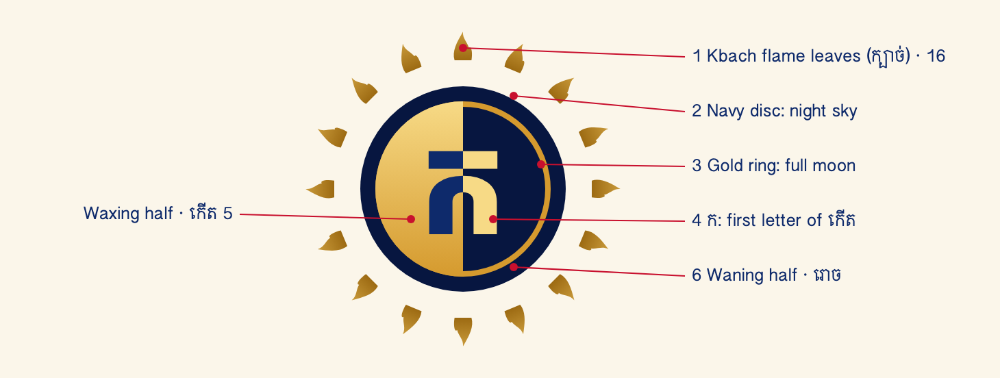

# Khmer Calendar logo: "Kbach Kor" (ក្បាច់ក)

<p align="center">
  
  &nbsp;&nbsp;
  
</p>

The logo puts the Khmer letter **ក** inside a moon that is half light and half dark, and surrounds it with a ring of
**kbach** (ក្បាច់), the flame-leaf ornament of Khmer art. It combines the two things the product is about: **being Khmer**
(script, ornament, colours) and **the Khmer lunar calendar** (the waxing and waning halves of every month).

---

## 1. Meaning

### English

| Element | What it means |
|---------|---------------|
| **ក (Kor)** | The first consonant of the Khmer alphabet and the first letter of **កើត**, the waxing moon. It stands for beginnings and puts Khmer script at the centre of the brand. |
| **Half-gold, half-dark moon** | The Khmer lunar month (ចន្ទគតិ) has two halves. The **gold left half** is **កើត**, the waxing days 1–15 Kert, when the moon fills with light. The **dark right half** is **រោច**, the waning days 1–15 Roch. The app exists to show exactly this. |
| **ក changes colour across the line** | The letter is dark on the light half and gold on the dark half. One day flows into the next and light passes to dark and back: the cycle of the calendar. |
| **Gold ring** | The full moon (ថ្ងៃពេញបូណ៌មី) and the completed month. |
| **16 kbach flames** | Kbach is the ornamental language carved on Angkor-era temples, painted in pagodas and woven into textiles. Here the leaves radiate like moonlight, making the mark unmistakably Khmer. The count of 16 is for even, balanced symmetry. |
| **Navy** | The night sky in which the moon is read, and the blue of the national flag. |
| **Gold** | Moonlight and the gilding of temples and palaces. |
| **Red** (accent) | The nation and its ceremonies, used in the wordmark and for highlights. |
| **Cream** (supporting) | The colour of palm-leaf manuscripts (សាស្ត្រាស្លឹករឹត), where calendars and teachings were recorded. |

### ភាសាខ្មែរ

| ធាតុ | អត្ថន័យ |
|------|---------|
| **អក្សរ ក** | ជាព្យញ្ជនៈទីមួយនៃអក្សរខ្មែរ និងជាអក្សរដំបូងនៃពាក្យ «កើត»។ វាតំណាងឱ្យការចាប់ផ្ដើម និងអត្តសញ្ញាណខ្មែរ។ |
| **ព្រះចន្ទពាក់កណ្ដាលមាស ពាក់កណ្ដាលងងឹត** | ខែចន្ទគតិខ្មែរមានពីរចំណែក។ ពាក់កណ្ដាលពណ៌មាសខាងឆ្វេង គឺ **ខាងកើត** (១កើត ដល់ ១៥កើត) ពេលព្រះចន្ទភ្លឺឡើងៗ។ ពាក់កណ្ដាលងងឹតខាងស្ដាំ គឺ **ខាងរោច** (១រោច ដល់ ១៥រោច)។ |
| **អក្សរ ក ប្ដូរពណ៌** | នៅលើផ្នែកភ្លឺ អក្សរ ក មានពណ៌ងងឹត ហើយនៅលើផ្នែកងងឹត វាមានពណ៌មាស។ នេះតំណាងឱ្យវដ្ដនៃថ្ងៃ និងខែ ពីភ្លឺទៅងងឹត ហើយត្រឡប់មកវិញ។ |
| **រង្វង់មាស** | ថ្ងៃពេញបូណ៌មី និងខែដែលពេញលេញ។ |
| **ក្បាច់ ១៦** | ក្បាច់ខ្មែរ ដែលឆ្លាក់លើប្រាសាទតាំងពីសម័យអង្គរ។ ក្បាច់ទាំងនេះបញ្ចេញរស្មីដូចពន្លឺព្រះចន្ទ។ |
| **ពណ៌ខៀវចាស់** | មេឃពេលយប់ និងពណ៌ខៀវនៃទង់ជាតិ។ |
| **ពណ៌មាស** | ពន្លឺព្រះចន្ទ និងការលម្អប្រាសាទ។ |
| **ពណ៌ក្រហម** | ជាតិ និងពិធីបុណ្យ។ |
| **ពណ៌ក្រែម** | ពណ៌សាស្ត្រាស្លឹករឹត ដែលដូនតាខ្មែរប្រើកត់ត្រាប្រតិទិន និងចំណេះដឹង។ |

> Please have a native Khmer copywriter proofread the Khmer text above before it is used in store listings or print.

---

## 2. Anatomy

<p align="center"></p>

- The waxing (gold) half is **always on the left**, which is the order the month is read in: កើត, then រោច.
- The vertical split runs through the centre of ក.
- Geometry (on a 512 grid): kbach ring radius 188 · navy disc r 150 · gold ring r 124 · moon half r 128.

---

## 3. Colours

| Name | HEX | RGB | Use |
|------|-----|-----|-----|
| Khmer Navy | `#0E2A6B` | 14 42 107 | Primary brand colour, text, ក on gold |
| Night | `#071640` | 7 22 64 | Disc, dark backgrounds, gradient end |
| Navy light | `#123383` | 18 51 131 | Gradient start |
| Moon Gold | `#F7DA86` → `#D59A2E` | — | Moon, kbach, ring (top-to-bottom gradient) |
| Deep Gold | `#C99A3A` → `#9C6A12` | — | Kbach on white/light backgrounds (contrast) |
| Royal Red | `#C8102E` | 200 16 46 | English wordmark, accents |
| Palm-leaf Cream | `#FBF6EA` | 251 246 234 | Light backgrounds, wordmark on dark |

The admin dashboard tokens (`khmer-calendar-admin/src/app/styles/tokens.css`) use Khmer Navy as primary in light mode,
Moon Gold in dark mode, and Royal Red as accent.

---

## 4. Typography

- **Wordmark:** "ប្រតិទិនខ្មែរ" and "KHMER CALENDAR" set in **Kantumruy Pro Bold** (SIL Open Font License, see
  `source/KantumruyPro-OFL.txt`), with the English letter-spaced.
- In the logo files all text has been **converted to outlines** (shaped with HarfBuzz so the Khmer subscripts in ប្រ and
  ខ្មែ are correct). The files don't depend on any installed font.
- For UI text next to the logo, use Kantumruy Pro or Noto Sans Khmer.

---

## 5. Files

All in [`logo/`](logo/). SVG is the master; PNGs are renders.

| File | Use |
|------|-----|
| `khmer-calendar-icon.svg` | Rounded app icon: web favicon, admin UI, presentations |
| `khmer-calendar-icon-fullbleed.svg` · `png/app-icon-1024.png` | Square, no rounding: **App Store / Play Store** source (the OS applies its own mask) |
| `khmer-calendar-icon-dev.svg` · `-staging.svg` | Internal builds only, with an orange **DEV** or purple **STG** band. **Never** ship these to a store |
| `khmer-calendar-mark.svg` | Mark without a tile, for dark or navy backgrounds |
| `khmer-calendar-mark-on-light.svg` | Mark for white/light backgrounds (deeper gold kbach for contrast) |
| `khmer-calendar-mark-mono.svg` | One colour (`currentColor`): stamps, embossing, single-ink print, watermarks |
| `khmer-calendar-lockup.svg` · `-on-dark.svg` | Horizontal logo: mark + Khmer + English name |
| `khmer-calendar-lockup-stacked.svg` · `-on-dark.svg` | Stacked logo: splash screens, posters, social avatars with room |
| `android/adaptive-*.svg` | Android adaptive icon layers (foreground per flavor, background, themed monochrome) |
| `png/favicon-32.png`, `apple-touch-icon-180.png`, `icon-192.png`, `icon-512.png` | Web icons |

---

## 6. Usage rules

**Clear space:** keep empty space around the mark of at least **¼ of the mark's width** on every side.

**Minimum size**

| Asset | Digital | Print |
|-------|---------|-------|
| App icon / mark | 24 px | 10 mm |
| Horizontal lockup | 32 px tall | 12 mm tall |
| Below 24 px | Use `khmer-calendar-icon.svg` (favicon); kbach detail becomes texture, which is acceptable | — |

**Do**
- Use the supplied files; scale proportionally.
- Use the navy tile or the on-light/on-dark variant that matches the background.
- Use the mono version when only one colour is available.

**Don't**
- ✗ Flip the moon (gold must be on the **left**, for waxing / កើត).
- ✗ Retype ក or the wordmark in another font, or use a different Khmer letter.
- ✗ Change the number or direction of the kbach leaves, or remove them on sizes above 24 px.
- ✗ Recolour outside the palette, add shadows, outlines, bevels or gradients beyond the supplied ones.
- ✗ Stretch, rotate, or place on busy photographs without a navy tile.
- ✗ Use the DEV/STG icons anywhere public.

---

## 7. Where it is installed

| Project | What uses the logo |
|---------|--------------------|
| **Mobile app** (`khmer_calendar_app/`) | Launcher icons per flavor on Android and iOS, from `flutter_launcher_icons-{dev,staging,production}.yaml`. Android has an adaptive icon with a themed (monochrome) layer; iOS uses `AppIcon-$(APP_FLAVOR)` via `tool/configure_ios_flavors.rb`. In the app, `core/widgets/brand_logo.dart` (Settings → About) shows `assets/branding/logo-mark.png` |
| **Admin** (`khmer-calendar-admin/`) | `public/favicon.svg`, PNG favicons, `apple-touch-icon.png`, `site.webmanifest`, the `BrandLogo` component (sidebar and login), and brand colour tokens |

---

## 8. Updating the logo

```bash
# 1. Edit branding/build_logo.py (geometry, colours, variants)
# 2. Regenerate every file and push them into the app + admin:
./branding/sync_assets.sh
```

`sync_assets.sh` runs `build_logo.py` (SVG + PNG via Google Chrome), copies the web files into the admin, copies the
icon masters into the app and runs `fvm dart run flutter_launcher_icons` for all three flavors.

To change **text** (wordmark, DEV/STG labels), regenerate the outlines in `source/outlines.json` first. This step needs
`fonttools` and `uharfbuzz` in a virtual environment, plus the Kantumruy Pro variable font from Google Fonts:

```bash
python3 -m venv /tmp/kc-venv && /tmp/kc-venv/bin/pip install fonttools uharfbuzz
/tmp/kc-venv/bin/python branding/source/outline_text.py KantumruyPro[wght].ttf branding/source/outlines.json
```

---

## 9. Origin & licence

- Original artwork created for this project. The first concept round is in [`concepts/index.html`](concepts/index.html)
  and the second in [`concepts/round2/index.html`](concepts/round2/index.html). This logo is concept **14**.
- Lettering is derived from Kantumruy Pro (© The Kantumruy Pro Project Authors, SIL OFL 1.1). The OFL allows its use in
  logos; the licence text is in `source/`.
- Before registering the logo as a trademark, run a trademark search in Cambodia (Department of Intellectual Property,
  Ministry of Commerce) and in your target app-store markets.
